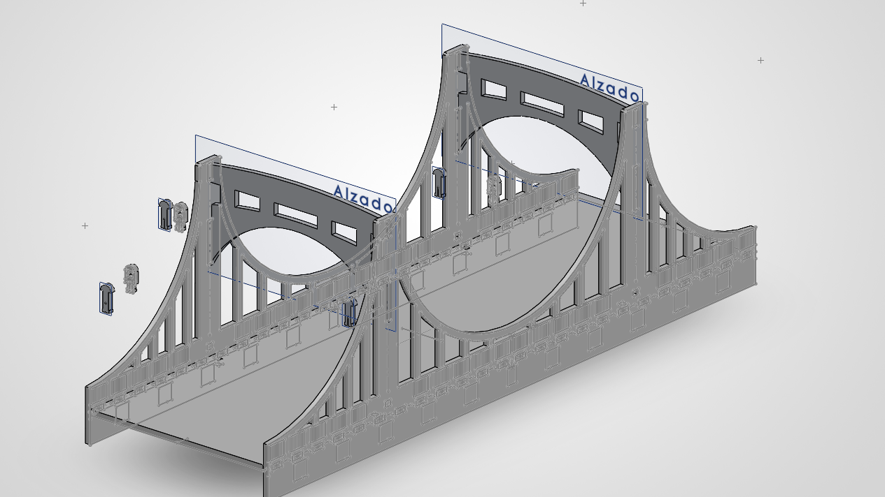

# Diseño de las piezas de ensamblaje de un puente para corte láser (SolidWorks)

El puente se construyó con láminas planas de carton cortadas con láser que se unen por pestañas y ranuras, sin pegamento. Por eso cada pieza se diseña en 2D, con el espesor del material como dato central.

## Piezas del ensamblaje

* **Paneles laterales (alzado):** llevan el perfil de las torres y los arcos, con ventanas rectangulares y ranuras para el tablero.
* **Base:** lámina central con pestañas que atraviesan los paneles laterales.
* **Barandales y detalles:** piezas delgadas con ranuras decorativas.
* **Seguros o clavijas:** piezas pequeñas que bloquean las uniones.

## Imagen del ensamblaje

### Archivos del proyecto

- [Ensamblaje completo](../recursos/archivos/Ensamblaje2.SLDASM)
- [Ensamblaje del cubo](../recursos/archivos/EnsamblajeCubo.SLDPRT)
- [Base del puente](../recursos/archivos/Puentebasecorregido.SLDPRT)
- [Arco del puente principal](../recursos/archivos/ArcoPuente%201%20-%20copia%20(1)%201.SLDPRT)
- [Arco del puente secundario](../recursos/archivos/ArcoPuente%201%20-%20copia%20(1)%201%20(1).SLDPRT)
- [Pieza puente tipo 1](../recursos/archivos/Puente%201%201%201%201.SLDPRT)
- [Pieza puente tipo 2](../recursos/archivos/Puente%201%201%201%201%20(1).SLDPRT)
- [Pin tipo 1 principal](../recursos/archivos/Pin1%201.SLDPRT)
- [Pin tipo 1 variante 1](../recursos/archivos/Pin1%201%20(1).SLDPRT)
- [Pin tipo 1 variante 2](../recursos/archivos/Pin1%201%20(2).SLDPRT)
- [Pin tipo 1 variante 3](../recursos/archivos/Pin1%201%20(3).SLDPRT)
- [Pin tipo 2 principal](../recursos/archivos/Pin2.SLDPRT)
- [Pin tipo 2 variante 1](../recursos/archivos/Pin2%20(1).SLDPRT)
- [Pin tipo 2 variante 2](../recursos/archivos/Pin2%20(2).SLDPRT)
- [Pin tipo 2 variante 3](../recursos/archivos/Pin2%20(3).SLDPRT)

## Cómo se hizo

1. **Perfil del alzado.** Dibujamos el croquis del panel lateral en el plano *Alzado*: Las torres y los arcos. Usamos *Extruir saliente/base* con profundidad igual al grosor establecido del material.
2. **Ranuras y pestañas.** Dibujamos las ranuras del panel con el ancho del grosor para que entren a presión. Las pestañas del tablero deben coincidir en posición y número con esas ranuras.
3. **Simetría.** Diseñamos un solo panel lateral y creamos el otro copiando el archivo.
4. **Seguros.** Hicimos ranuras pequeñas en las pestañas de la base y las partes laterales, y diseñamos clavijas con el mismo grosor para trabar la unión una vez ensamblada.

## Exportación

* Insertamos todos los croquis de cada pieza en un solo croquis
* Exportamos el conjunto de croquis como DXF en milímetros y escala 1:1.
* Hicimos una prueba con solo una de las piezas antes de cortar todas las piezas con el material final.