# Mi práctica con las máquinas del IDIT

(Fecha: ________)

En esta práctica el profesor Oliver nos enseñó primero a medir piezas pequeñas con herramientas de precisión, y después nos explicó cómo se usan varias máquinas del taller.

## Parte 1: Aprendiendo a medir

Las herramientas de medición que vimos fueron el **vernier** y el **micrómetro**. Las dos sirven para medir cosas muy pequeñas con bastante exactitud.

- **Vernier:** es la más rápida de usar. Se ocupa para piezas mecánicas, trabajos de metal y para revisar que una pieza salió bien.
- **Micrómetro:** se usa cuando una diferencia de centésimas o milésimas de milímetro puede hacer que una pieza ya no funcione.

El profesor nos dijo que hay dos tipos de vernier. El **analógico** se ajusta a mano y uno mismo tiene que leer la medida en las escalas. El **electrónico** muestra el número en una pantalla: solo se ajusta, se pone en cero y listo.

Para el micrómetro, primero se pone la pieza entre las dos puntas dejándola un poco floja. Luego se va cerrando poco a poco, sin apretar con fuerza.

Después de la explicación practicamos con unos cubos de madera. Yo medí con un vernier analógico marca Metromex, que tiene escala en milímetros (con precisión de 0.05 mm) y también en pulgadas (1/128 in).

### Medidas que obtuve

**Con el vernier** (en centímetros):

| Bloque | Ancho | Largo | Altura |
| --- | --- | --- | --- |
| 15 | 4.7 cm | 5 cm | 2.15 cm |
| 7 | 3.67 cm | 4.06 cm | 1.84 cm |
| 17 | 3.2 cm | 4.2 cm | 2.99 cm |
| 6 | 3.2 cm | 4.36 cm | 2.81 cm |

**Con el micrómetro** (en milímetros), solo medí el bloque 7:

| Bloque | Largo | Ancho | Altura |
| --- | --- | --- | --- |
| 7 | 40.55 mm | 36.56 mm | menor a 25 mm |

Al comparar, las medidas del bloque 7 casi coinciden entre las dos herramientas: con el vernier el largo salió 4.06 cm (40.6 mm) y el ancho 3.67 cm (36.7 mm), y con el micrómetro 40.55 mm y 36.56 mm. La diferencia es de apenas una décima de milímetro, y la altura (1.84 cm) también es menor a 25 mm.

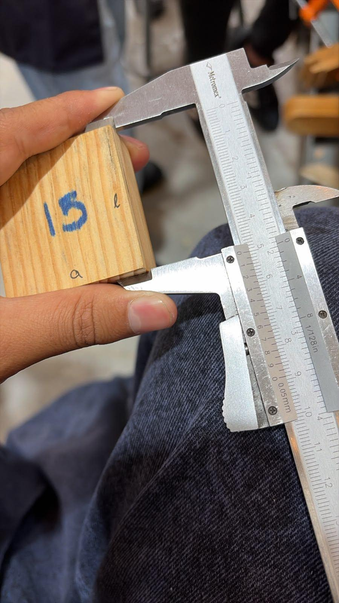{ width="60%" }

Medición del cubo 17 con el micrometro.

{ width="60%" }

Medición del cubo 15.

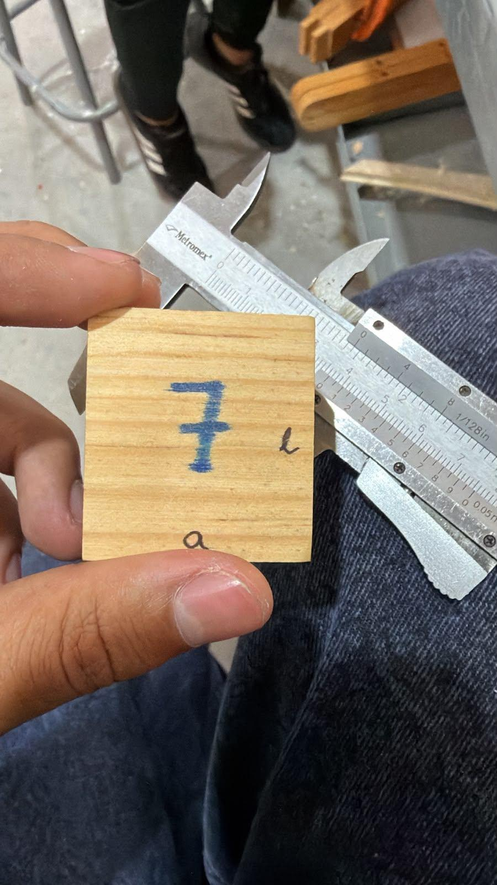{ width="60%" }

Medición del cubo 7.

## Parte 2: Conociendo las máquinas

Ese mismo día el profesor nos explicó cómo funcionan estas máquinas:

- Soldadora de puntos
- Dobladora de lámina
- Guillotina (cizalla)
- Sierra de cinta
- Fresadora

Antes de usar cualquiera, nos recordó que todas tienen sistemas de seguridad y que hay que usar el equipo de protección.

## Soldadora de puntos

Empezamos con la soldadora de puntos. Se usa para unir dos piezas de metal en un punto. Al presionar la palanca, pasa una corriente eléctrica por las puntas de cobre y el metal se suelda.

El profesor nos recomendó no dejar presionado mucho tiempo, porque la soldadura se puede pegar y se puede dañar la pieza o la máquina.

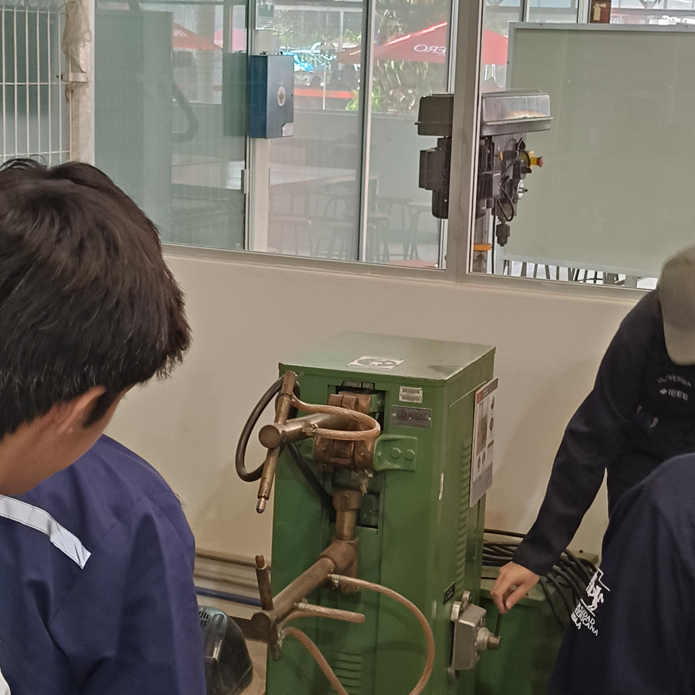{ width="60%" }

Soldadora de puntos vista de lado.

## Dobladora de lámina

Después pasamos a la dobladora de lámina, de la marca Dynamo. Como dice su nombre, se usa para doblar piezas de lámina, y igual que la guillotina funciona con la fuerza de la persona que la usa.

Es sencilla: se mete la lámina entre las piezas de sujeción, se aprietan y se levanta la palanca para hacer el doblez. Se pueden hacer dobleces en distintos ángulos, según cómo la manejemos. Se puede usar entre una o dos personas, pero con dos es más cómodo.

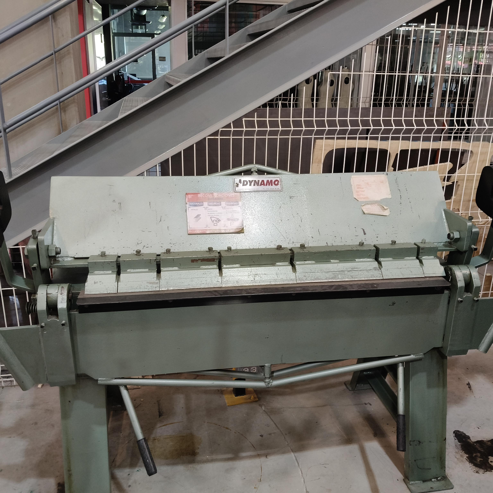{ width="60%" }

Dobladora de lámina de frente.

## Guillotina

Enseguida vimos la guillotina, una máquina para cortar lámina. La que usamos era de la marca Disher y funciona con un pedal: se coloca la lámina contra las guías, la persona se para en el pedal y con su peso baja la cuchilla y hace el corte.

El profesor nos dijo que es más fácil hacerlo entre dos personas. También nos pidió no subirnos al pedal con los dos pies, porque cuando regresa, la fuerza de la máquina nos puede tirar.

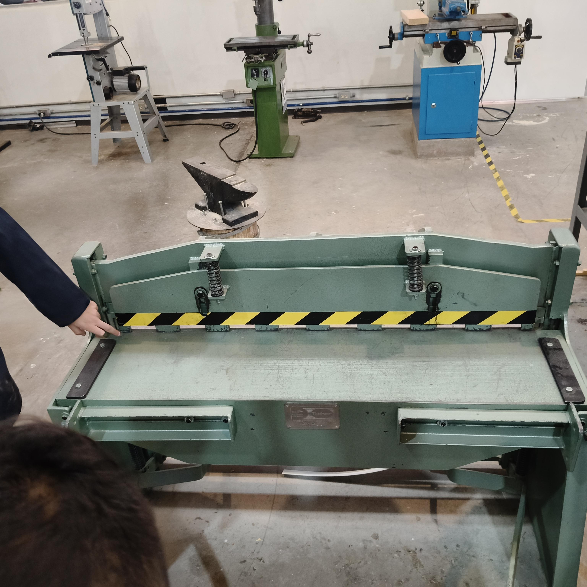{ width="60%" }

Guillotina de pedal, vista de frente.

También vimos una cizalla de palanca, más pequeña, que corta con la fuerza del brazo.

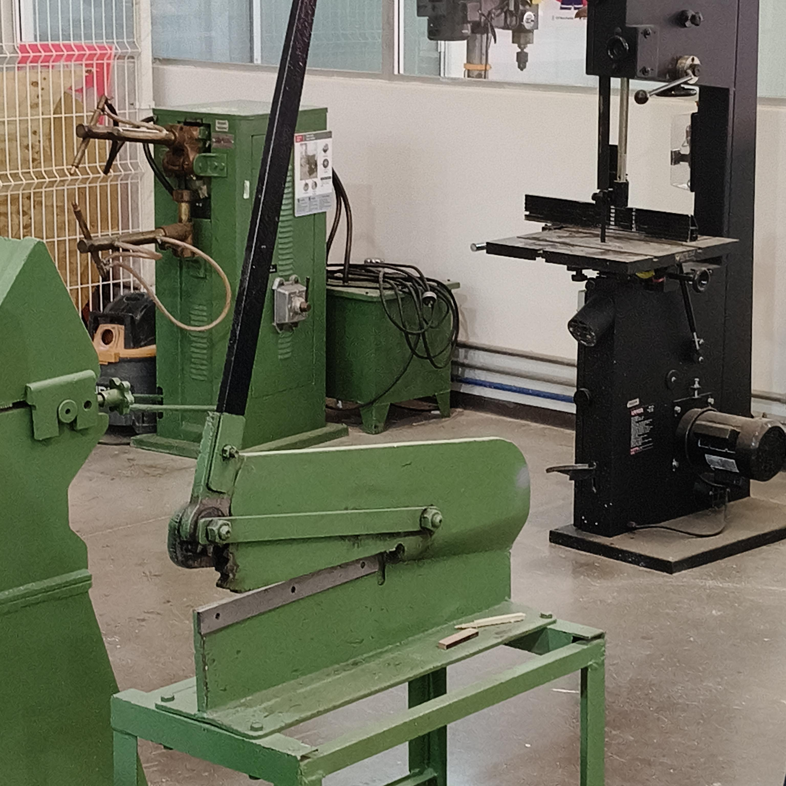{ width="60%" }

Cizalla de palanca. Atrás se ven la soldadora de puntos y la sierra de cinta.

<!-- Espacio para otra foto: { width="60%" } -->

## Sierra de cinta

Más adelante llegamos a la sierra de cinta. Corta con una hoja larga en forma de cinta, y sirve para hacer cortes rectos o con curvas en madera y en algunos plásticos. En el taller vimos dos: una negra de la marca Urrea y otra azul con gris de la marca Makita.

Lo más importante que nos dijo el profesor es que hay que cortar siempre con las dos manos. Si se corta con una sola, la sierra puede empujar la pieza hacia atrás por la fuerza que lleva. Además, la sierra se puede subir y bajar con una manivela para dejar la guía justo arriba de la pieza y tener más control.

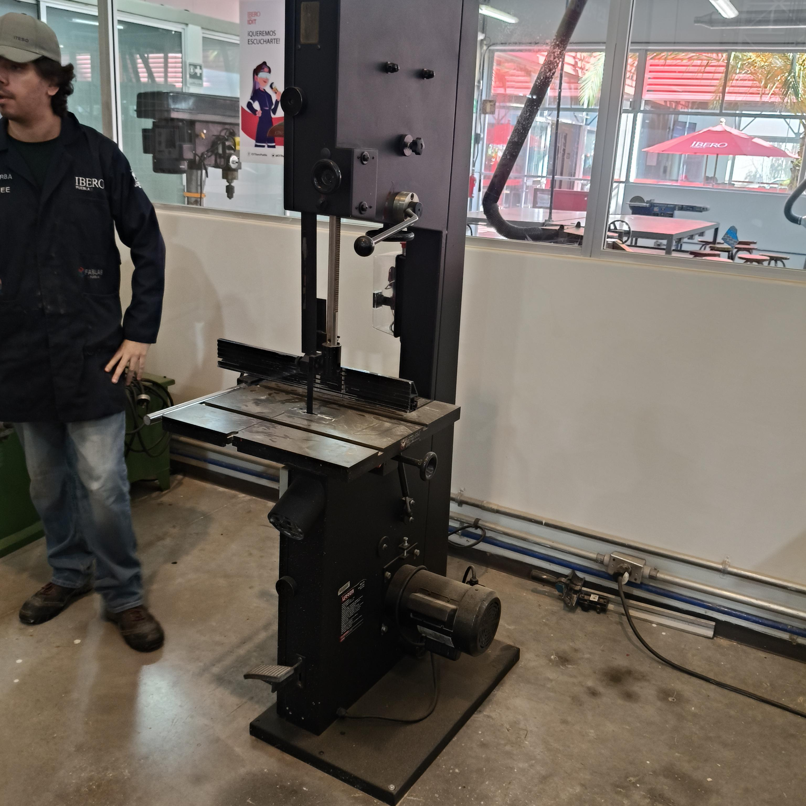{ width="60%" }

Sierra de cinta Urrea.

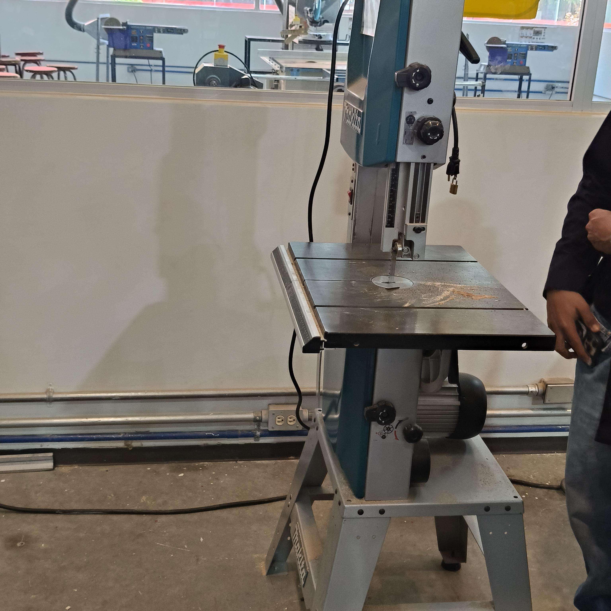{ width="60%" }

Sierra de cinta Makita.

## Fresadora

Terminamos con la fresadora, que era de la marca Titanium, modelo TMD-50PRO. Según su placa, puede taladrar hasta 2" y fresar hasta 1". Sirve para trabajar madera, metal y algunos plásticos.

El profesor explicó que hay que elegir bien la fresa, según el material y lo que se quiere hacer, para no dañar la máquina ni la pieza. También se escoge la velocidad: la placa de la máquina muestra varias velocidades que van desde 140 hasta 2100 RPM, dependiendo de la posición de las poleas. La pieza se sujeta con una prensa, y la máquina tiene una palanca para bajar la fresa y otras manivelas para mover la mesa de lado a lado.

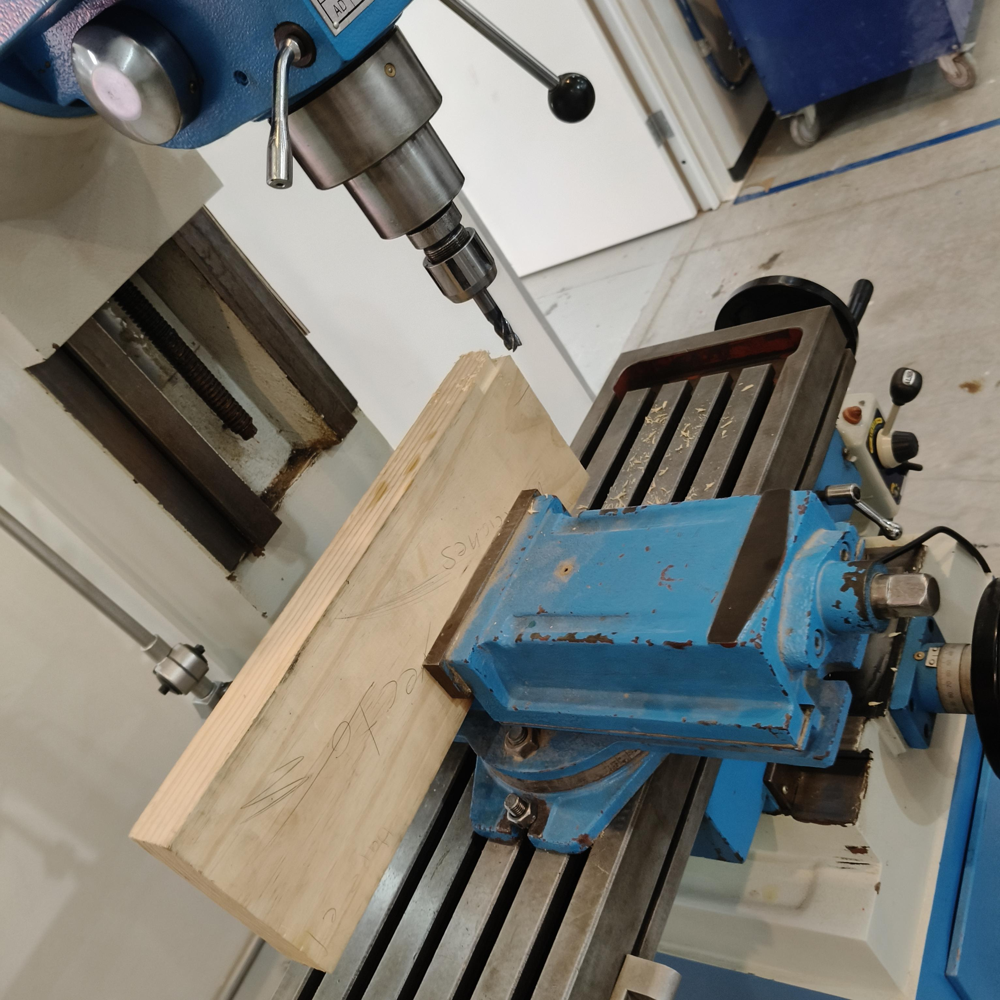{ width="60%" }

Pieza de madera sujeta en la prensa de la fresadora.

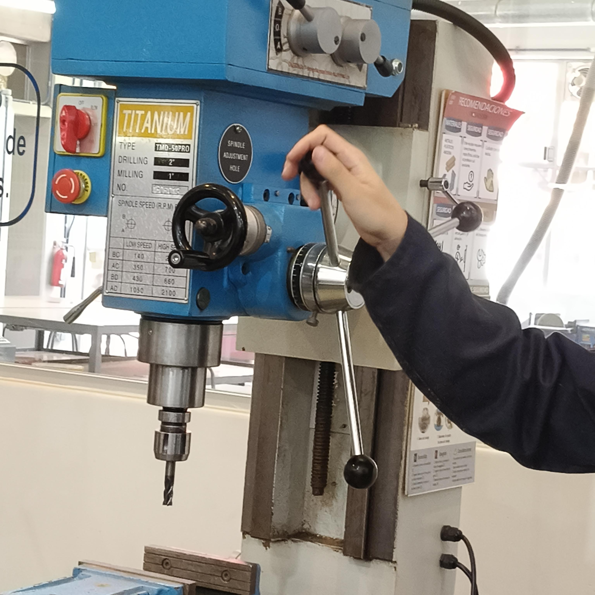{ width="60%" }

Fresadora de frente. Se ve la palanca que baja la fresa.

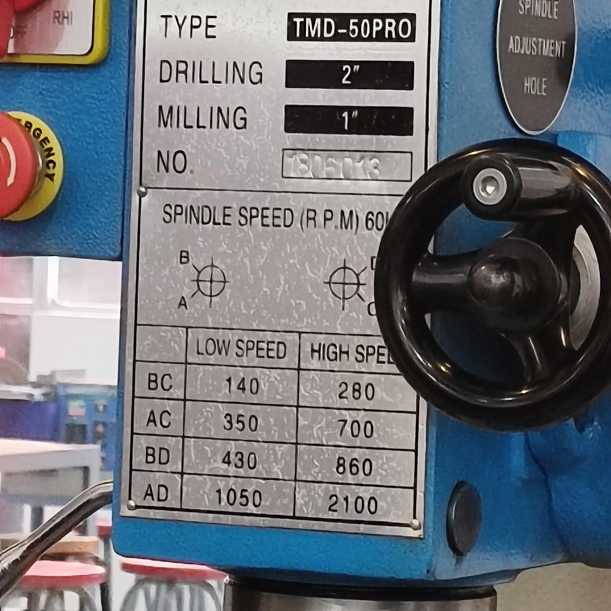{ width="60%" }

Placa de la fresadora con el modelo y las velocidades (RPM).

## Conclusiones

En esta práctica aprendí a usar el vernier y a leer sus escalas, y también entendí para qué sirve cada máquina del taller. Me quedó claro que cada una tiene su forma correcta de usarse, y que seguir las indicaciones de seguridad es lo que evita accidentes y cuida tanto las máquinas como a nosotros.
