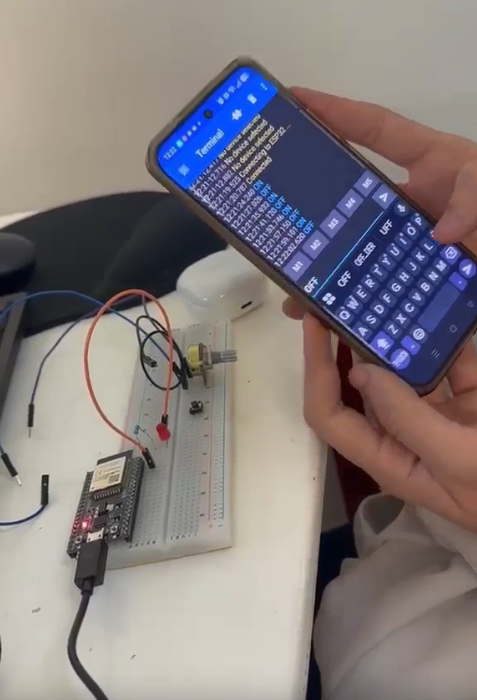
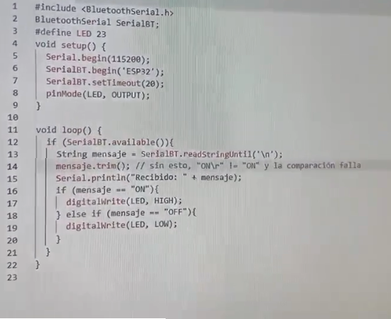

<html>
    <head>
        <meta charset="utf-8">
        <meta name="viewport" content="width=device-width, initial-scale=1">
        <title>Bluetooth</title>
	    <link rel="preconnect" href="https://fonts.googleapis.com"> <!-- Estas lineas de google fonts son para implementar fuentes de texto en la pagina web -->
	    <link rel="preconnect" href="https://fonts.gstatic.com" crossorigin>
	    <link href="https://fonts.googleapis.com/css2?family=Caacupe+One&family=DM+Sans:ital,opsz,wght@0,9..40,100..1000;1,9..40,100..1000&family=Passion+One:wght@400;700;900&display=swap" rel="stylesheet">
        
    </head>
    <body markdown="1">
        <h1>Comunicación Bluetooth</h1>
        <h2>Video funcionamiento</h2>
        
        
(hacer click en la imagen ^ para el video)

        
        

        El codigo para la comunicación entre el Bluetooth y la terminal es un programa que simplemente recibe lo escrito en el celular, y dependiendo de si es ON o OFF, prende o apaga el LED.

        <h2>Reporte de Fallas</h2>
        
Esta vez no hubo ninguna falla, fue un codigo y circuito relativamente facil de implementar.

        <h2>Conclusiones</h2>
        
En conclusión este código es básico de cómo realizar una comunicación por Bluetooth al ESP32 y comunicarse con este desde el dispositivo que vayamos a usar para enviar comandos o mensajes. 

    </body>
</html>