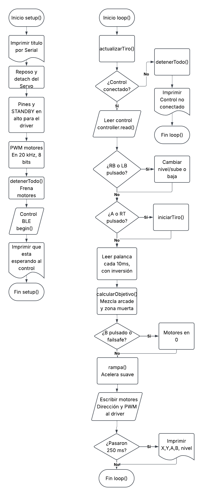
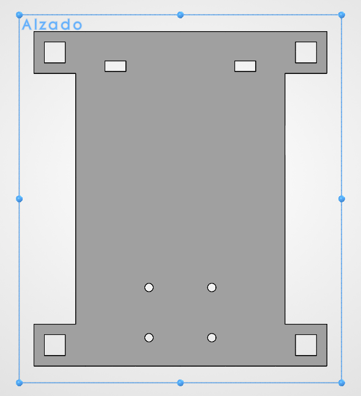

<html>
    <head>
        <meta charset="utf-8">
        <meta name="viewport" content="width=device-width, initial-scale=1">
        <title>Proyecto Carro Bluetooth</title>
	    <link rel="preconnect" href="https://fonts.googleapis.com"> <!-- Estas lineas de google fonts son para implementar fuentes de texto en la pagina web -->
	    <link rel="preconnect" href="https://fonts.gstatic.com" crossorigin>
	    <link href="https://fonts.googleapis.com/css2?family=Caacupe+One&family=DM+Sans:ital,opsz,wght@0,9..40,100..1000;1,9..40,100..1000&family=Passion+One:wght@400;700;900&display=swap" rel="stylesheet">
        
    </head>
    <body markdown="1">
        <h1>Proyecto 1: Carro por Bluetooth</h1>
        
<b>Institución -</b> Universidad Iberoamericana Puebla  
        <b>Materia -</b> Introducción a la Mecatrónica 
        <b>Integrantes:</b> Daniel Alejandro Trejo Macías Carlos Mario Diaz Moscoso Johan Mauricio Cerqueda Rojas Jose Pablo Sanchez Guerrero Abraham Ramirez Garcia
        

        <h2>Objetivo</h2>
        
Construir en equipo un carro controlado por Bluetooth, integrando los conocimientos del curso (electrónica, microcontrolador, actuadores, comunicación y mecanismos), el cual será usado en un torneo de fútbol RC

        <h2>Requisitos</h2>
        <h3>Funcionales</h3>
        <ul>
            <li>El carro se mueve adelante, atrás, izquierda, derecha y alto por comandos Bluetooth.</li>
            <li>Control de velocidad por PWM (mínimo 3 niveles o velocidad proporcional).</li>
            <li>El protocolo de comandos está documentado en el portafolio (qué comando hace qué).</li>
            <li>Failsafe: si se pierde el enlace o no llegan comandos en ≤1 s, el carro se detiene solo.</li>
            <li>Interruptor físico de encendido/apagado accesible sin desarmar nada.</li>
            <li>Alimentación de motores separada del ESP32 (con GND común), como se vio en el tema de Actuadores</li>
            <li>Cableado ordenado y sujeto: nada de cables sueltos arrastrando</li>
            <li>Superficie plana horizontal de al menos 6 × 6 cm en la parte superior, despejada: ahí vivirá el marcador ArUco del Proyecto Final.</li>
        </ul>
        <h3>Propios</h3>
        <ul>
            <li>Que sea controlable mediante un control de Xbox</li>
            <li>Que tenga pinzas rigidas enfrente para maniobrar la pelota</li>
            <li>Que pueda moverse con dos llantas traseras y una frontal</li>
            <li>Los cables de los motores deben poder atravesar el chasis 
            para poder conectarlos al puente H</li>
            <li>Que cuente con carrocería para restringir los contenidos del chasis y así no se salgan</li>
            <li>Que use un servo en las pinzas para "patear" la pelota.</li>
        </ul>
        <h2>Arquitectura</h2>
        
        <h2>Plan por semanas</h2>
        <ul>
            <li>Semana 1: Programación del codigo inicial, Diseño del chasis, Diseño y programación de la app de prueba para controlar el carro</li>
            <li>Semana 2: Cableado del ESP32, Puente H y Motores, Diseño de la carrocería, Soldado de los cables, Impresión del chasis y de la carrocería, Ajustes al código para manejar por control al carro.</li>
        </ul>
        <h2>Criterios de exito</h2>
        <ul>
            <li>Cumplir con todos los requisitos funcionales</li>
            <li>Que el carro se pueda manejar mediante un control</li>
            <li>No exceder el limite de área de 20x20cm</li>
        </ul>
        <h2>Boceto del chasis</h2>
        
        <h2>BOM</h2>
        <table>
            <thead>
                <tr>
                    <th>Componente</th>
                    <th>Precio</th>
                    <th>Obtención</th>
                </tr>
            </thead>
            <tbody>
                <tr>
                    <td>Portapilas</td>
                    <td>$70</td>
                    <td>Comprado</td>
                </tr>
                <tr>
                    <td>Power Bank</td>
                    <td>$350</td>
                    <td>Comprado</td>
                </tr>
                <tr>
                    <td>Baterias</td>
                    <td>$440</td>
                    <td>Comprado</td>
                </tr>
                <tr>
                    <td>Servo</td>
                    <td>100</td>
                    <td>Comprado</td>
                </tr>
                <tr>
                    <td>ESP32</td>
                    <td>$180</td>
                    <td>Reutilizado</td>
                </tr>
                <tr>
                    <td>Puente H TB6612</td>
                    <td>$102</td>
                    <td>Prestado</td>
                </tr>
                <tr>
                    <td>Motores TT con caja reductora</td>
                    <td>$140</td>
                    <td>Prestado</td>
                </tr>
                <tr>
                    <td>Llantas de plastico</td>
                    <td>$49</td>
                    <td>Comprado</td>
                </tr>
                <tr>
                    <td>Rueda loca</td>
                    <td>$20</td>
                    <td>Comprado</td>
                </tr>
                <tr>
                    <td>Tonillos y tuercas</td>
                    <td>$10</td>
                    <td>Prestado</td>
                </tr>
                <tr>
                    <td>Power Bank</td>
                    <td>$350</td>
                    <td>Comprado</td>
                </tr>
                <tr>
                    <td>Impresión del Chasis</td>
                    <td>$16</td>
                    <td>Prestado</td>
                </tr>
                <tr>
                    <td>Impresión de la Carrocería</td>
                    <td>$60</td>
                    <td>Prestado</td>
                </tr>
                <tr>
                    <td>Jumpers</td>
                    <td>$60</td>
                    <td>Prestado</td>
                </tr>
                <tr>
                    <td>Mini switch</td>
                    <td>$20</td>
                    <td>Comprado</td>
                </tr>
            </tbody>
        </table>
        <h2>Análisis de riesgos</h2>
        <ul>
            <li>Sobreesfuerzo del servo resultando en que deje de funcionar - Reemplazar con otro servo</li>
            <li>Se deshaga alguna soldadura - Volver a soldar</li>
            <li>Descarga de baterías - Sustituir por otras baterias mientras las anteriores se recargan</li>
            <li>Los motores avancen muy lento - Usar un powerbank para mas alimentación</li>
            <li>El carro no se mueve - Verificar conexiones</li>
        </ul>
        <h2>Bitácora de fallas</h2>
        <table>
            <thead>
                <tr>
                    <th>¿Qué falló?</th>
                    <th>¿Cómo lo encontraron?</th>
                    <th>¿Cómo lo resolvieron?</th>
                </tr>
            </thead>
            <tbody>
                <tr>
                    <td>El servo hacía todos los movimientos que debían ir a los motores</td>
                    <td>Usamos la app prototipo para controlar el servo y motores</td>
                    <td>Corregimos unas conexiones sueltas</td>
                </tr>
                <tr>
                    <td>El servo nunca se detenía</td>
                    <td>Usamos el control de Xbox para controlar el carro una vez que terminamos las conexiones</td>
                    <td>Ajustamos el código para asegurar que el servo se detuviera</td>
                </tr>
                <tr>
                    <td>El servo dejó de funcionar por sobreesfuerzo</td>
                    <td>Luego de corregir el codigo el servo ya se detenía internamente, pero el componente externo todavía no giraba</td>
                    <td>Conseguimos un servo de reemplazo, pero ya no hubo tiempo para sustituir las conexiones, asi que descartamos el uso del servo</td>
                </tr>
                <tr>
                    <td>El carro no se movía</td>
                    <td>Probamos varías veces a encender el carro para ver si ya funcionaba, pero ninguno de los motores se movía</td>
                    <td>Verificamos las conexiones y reemplazamos las baterías, además de que volvimos a subir el código</td>
                </tr>
            </tbody>
        </table>
        <h2>Video de funcionamiento</h2>
        <a href="../../recursos/videos/VideoCarroBT.mp4">
            Haz click aqui para el video
        </a>
        <h2>Requisitos vs Resultados</h2>
        <table>
            <thead>
                <tr>
                    <th>#</th>
                    <th>Requisito</th>
                    <th>¿Se cumplió?</th>
                </tr>
            </thead>
            <tbody>
                <tr>
                    <td>1</td>
                    <td>El carro se mueve adelante, atrás, izquierda, derecha y alto por comandos Bluetooth.</td>
                    <td>Si</td>
                </tr>
                <tr>
                    <td>2</td>
                    <td>Control de velocidad por PWM (mínimo 3 niveles o velocidad proporcional).</td>
                    <td>Si</td>
                </tr>
                <tr>
                    <td>3</td>
                    <td>El protocolo de comandos está documentado en el portafolio (qué comando hace qué).</td>
                    <td>Si</td>
                </tr>
                <tr>
                    <td>4</td>
                    <td>Failsafe: si se pierde el enlace o no llegan comandos en ≤1 s, el carro se detiene solo.</td>
                    <td>Si</td>
                </tr>
                <tr>
                    <td>5</td>
                    <td>Interruptor físico de encendido/apagado accesible sin desarmar nada.</td>
                    <td>Si</td>
                </tr>
                <tr>
                    <td>6</td>
                    <td>Alimentación de motores separada del ESP32 (con GND común), como se vio en el tema de Actuadores</td>
                    <td>Si</td>
                </tr>
                <tr>
                    <td>7</td>
                    <td>Cableado ordenado y sujeto: nada de cables sueltos arrastrando</td>
                    <td>Si</td>
                </tr>
                <tr>
                    <td>8</td>
                    <td>Superficie plana horizontal de al menos 6 × 6 cm en la parte superior, despejada: ahí vivirá el marcador ArUco del Proyecto Final.</td>
                    <td>Si</td>
                </tr>
                <tr>
                    <td>9</td>
                    <td>Que sea controlable mediante un control de Xbox</td>
                    <td>Si</td>
                </tr>
                <tr>
                    <td>10</td>
                    <td>Que tenga pinzas rigidas enfrente para maniobrar la pelota</td>
                    <td>Si</td>
                </tr>
                <tr>
                    <td>11</td>
                    <td>Que pueda moverse con dos llantas traseras y una frontal</td>
                    <td>Si</td>
                </tr>
                <tr>
                    <td>12</td>
                    <td>Los cables de los motores deben poder atravesar el chasis para poder conectarlos al puente H</td>
                    <td>Si</td>
                </tr>
                <tr>
                    <td>13</td>
                    <td>Que cuente con carrocería para restringir los contenidos del chasis y así no se salgan</td>
                    <td>Si</td>
                </tr>
                <tr>
                    <td>14</td>
                    <td>Que use un servo en las pinzas para "patear" la pelota.</td>
                    <td>No</td>
                </tr>
            </tbody>
        </table>
        <h2>Lecciones aprendidas</h2>
        <ol>
            <li>Hacer el trabajo con anticipación - Hacer avances desde que el proyecto fue encargado nos ayudó a usar el amplio tiempo para corregir errores que se iban presentando.</li>
            <li>Checar que las conexiones estén bien - En muchas ocasiones cuando algo fallaba, al verificar las conexiones nos dabamos cuenta de que una de las conexiones se había separado, y al corregirlo funcionaba después en la mayoría de los casos.</li>
            <li>Asegurarse de que el material comprado sea el adecuado - Cuando estabamos a punto de conectar el portapilas, notamos que era demasiado pequeño para las pilas que usaríamos, asi que terminamos gastando dinero de más.</li>
        </ol>
        
Se utilizó Claude AI para generar la estructura del diagrama del código, el esquematico de conexiones, y la estructura del README del carro

    </body>
</html>