# Practica con las maquinas del IDIT

(Septiembre/25/2026)

El día de hoy nos toco trabajar ah todos en la explanada del IDIT ya que aparte de hacer entrega de un proyecto el profesor Oliver nos enseño a medir diferentes piezas de diferentes tamaños con dos herramientas distintas , las cuales eran un “BERNIER” y un “MICROMETRO” , estas herramientas de medición principalmente nos sirven para medir medidas muy pequeñas.

- BERNIER: medición rápida de piezas mecánicas, carpinteria metálica y control del calidad.

- MICROMETRO: trabajos donde una diferencia de centésimas o milésimas de milímetro altera el funcionamiento de una pieza

El profesor nos explico que en el caso del “BERNIER” hay de dos tipos , el analógico y el electrónico , su principal diferencia es que en el analogico tenemos que hacer la medición de manera manual , ajustando el bernier y nosotros mismos sacar la medida. En el electrónico el bernier hace todo el trabajo , solo tenemos que ajustar en el espacio que queramos y mover a cero y nos lo dará.

Con el micrómetro lo que tenemos que hacer primero es colocar la pieza a medir deseada entre los dos espacios , que quede un poco floja y luego ajustarlo poco a poco sin usar fuerza para apretar.

Después de que nos explicara como medir con las dos herramientas tuvimos que practicar midiendo unos cubos de madera tanto con el bernier y el micrómetro , ah estos les medimos su ancho , altura y profundidad y las medidas fueron las siguientes.

| Cubo | A | L | H |
| --- | --- | --- | --- |
| 5 | 25.89mm | 28.09mm | 23.35mm |
| 15 | 46.96mm | 50.17mm | 23.23mm |
| 17 | 32.21 | 41.34 | 29.89mm |
| 6 | 32.34mm | 43.45 | 28.55mm |
| 16 | 30.01mm | 37mm | 25.34mm |

Las medidas las sacamos tanto con el bernier y el micrómetro , tanto las medidas del bernier y el micometro coincidieron.

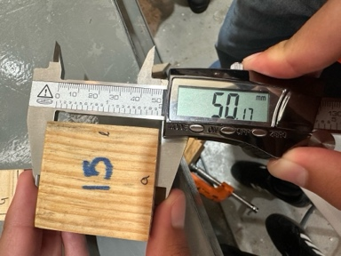{ width="72%" }

Medida de un cubo con el bernier 

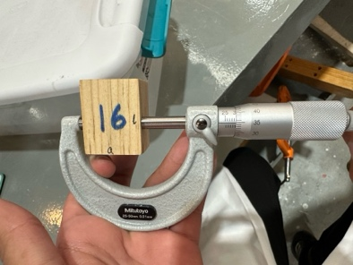{ width="72%" }

Medida de un cubo con el micrometro

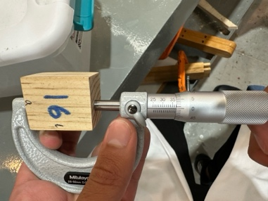{ width="72%" }

Medida de un cubo con el micrometro

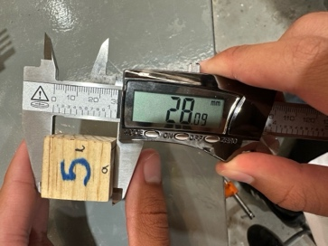{ width="72%" }

Medida de un cubo con el bernier 

## Segunda parte de la practica en el IDIT

Este mismo día después de medir los cubos con las herramientas de medición el profesor nos explico el funcionamiento de diferentes maquinas que se encuentran en el IDIT las cuales fueron las siguientes 

- Soldadura de dos puntos

- Dobladora de lamina

- Guillotina

- Sierra de cinta

- Fresadora

Primero empezamos con la fresadora la cual nos sirve para perforar diferente tipo de material , tanto madera , metal y algunos plásticos, como todas las maquinas el profesor nos explico que esta tenia diferentes medidas de seguridad parra evitar accidentes , y tendríamos que desactivar todos para poder arrancar la maquina , el profesor nos explico que para no dañar la maquina teníamos que elegir que fresa elegir para su uso correcto , esto depende del tipo de material y lo que queramos hacer , también nos explico que dependiendo el corte que queramos hacer podíamos elegir las revoluciones a la que la máquina podría trabajar , la maquina contaba con una palanca para controlar la altura del corte y para controlar el movimiento en horizontal.

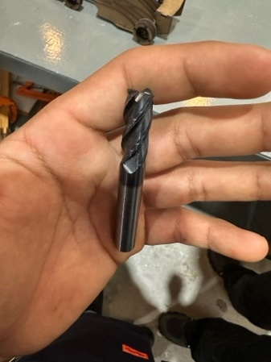{ width="72%" }

Fresa en buen estado

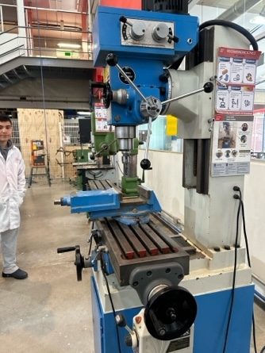{ width="72%" }

Fresadora de lado donde se pueden ver la palancas de movimiento

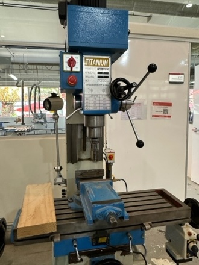{ width="72%" }

Fresadora de frente donde se pueden ver las revoluciones

## Sierra de Cinta

Después pasamos a otra sierra la cual tenía nombre de “Sierra de cinta” , esta nos sirve para realizar cortes continuos , rectos o curvos , en una gran variedad de materiales como madera , algunos platicos etc. 

Algo importante que nos explico el profesor fue que a la hora de cortar lo hiciéramos con las dos manos ya que al momento de cortar la sierra si solo lo hacíamos con una sola mano corríamos el riesgo de que la sierra nos lanzara el material de regreso por la fuerza que esta aplicando , esta maquina también cuenta con una palanca para subir y bajar la sierra y asi tener mejor control sobre ella.

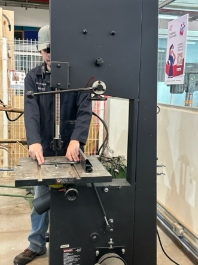{ width="72%" }

Sierra de Cinta de perfil 

## Guillotina

Después pasamos a una maquina llamada “Guillotina” , la principal función de esta maquina es hacer corte de laminas de aluminio , su funcionamiento es bastante simple y a diferencia de las demás esta funciona con el peso de la persona que la esta utilizando, la lamina de aluminio que se vaya a cortar se acomoda en los espacios que indica la maquina para posteriormente la persona se sube en el pedal para hacer fuerza hacia abajo y así poder cortar la lamina deseada , el profesor nos explico que es mejor hacerlo de dos personas ya que es mas fácil , también nos explico que a la hora de subirse al pedal no lo hiciéramos con los dos pies ya que por la fuerza de la maquina podía tirarnos al regresar el pedal.

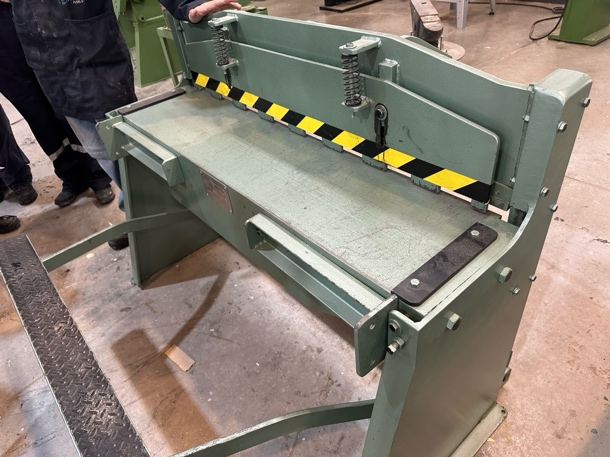{ width="72%" }

Guillotina de frente 

## Dobladora de Aluminio

Despues pasamos a una maquina que se llama “Dobladura de aluminio” y como su nombre lo dice esta enfocada a doblar piezas de aluminio y al igual que la guillotina esta funciona manualmente con la fuerza de la persona que la este utilizando.

Su funcionamiento es bastante simple , colocas la pieza deseada sobre la maquina y la ranuras que tiene , esta maquina puede hacer dobleces en diferentes ángulos, estos dependen de la persona que los este utilizando , esta maquina también es mas fácil de usar con dos personas pero se puede usar con una personas sin problema.

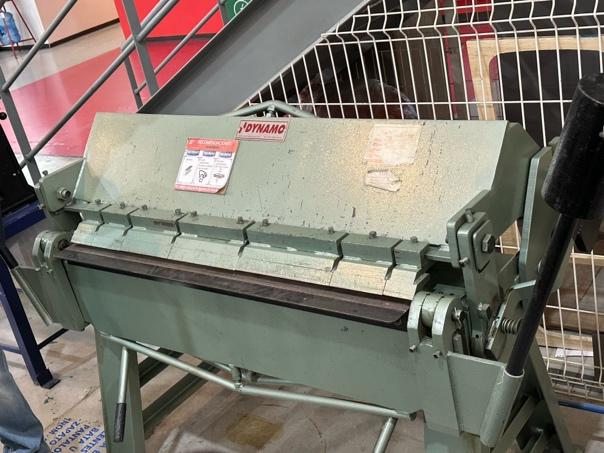{ width="72%" }

Dobladora de aluminio de frente 

## Soldadura de dos Puntos

Por ultimo pasamos a una maquina que se llama “Soldadura de dos puntos “ , esta como su nombre lo dice se usa para soldar dos puntos deseados , su funcionamiento también es bastante fácil , se presiona un pedal el cual transmite una corriente eléctrica la cual hace que se solden los puntos deseados , el profesor nos explico que cuando la ocupemos no mantengamos el pedal pisado mucho tiempo ya que se podría pegar la soldadura y se podría dañar.

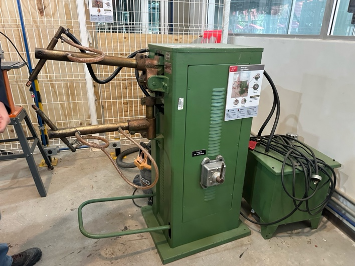{ width="72%" }

Soldadura de dos puntos de lado 

## CONCLUSIONES

En esta clase aprendí bastante de diferentes cosas , tanto el funcionamiento de herramientas de medición tanto analógicas como electrónicas , también aprendí a usar las diferentes tipos de maquinas con las que contamos , usarlas de manera correcta para su buen funcionamiento y evitar así accidentes .
