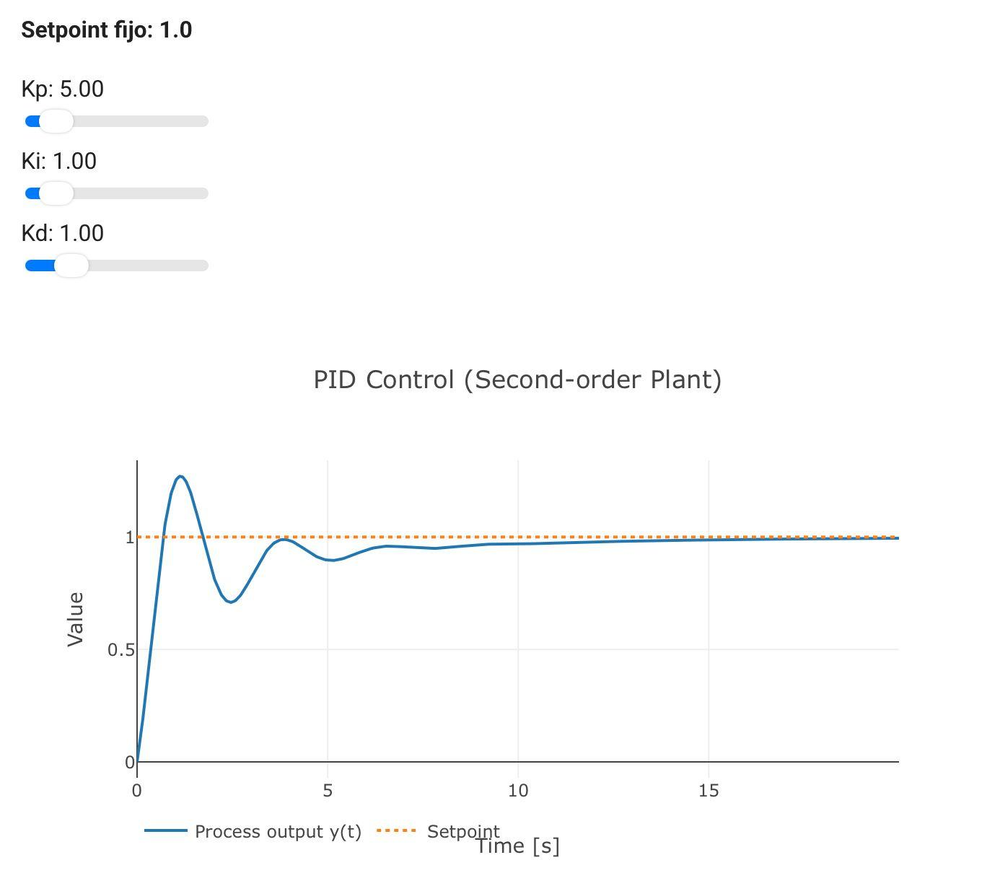
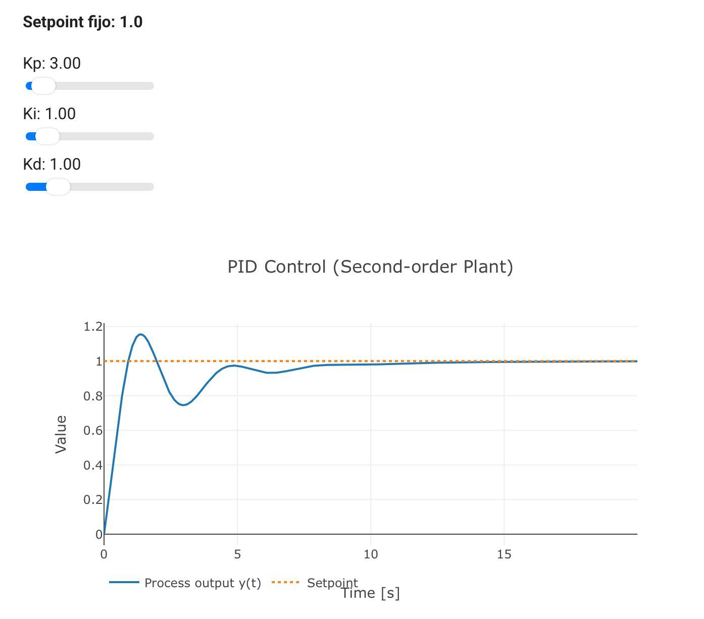

<html>
    <head>
        <meta charset="utf-8">
        <meta name="viewport" content="width=device-width, initial-scale=1">
        <title>Control PID</title>
        <link rel="icon" type="image/png" href="https://img.icons8.com/?size=100&id=1581&format=png" sizes="32x32">
	    <link rel="preconnect" href="https://fonts.googleapis.com"> <!-- Estas lineas de google fonts son para implementar fuentes de texto en la pagina web -->
	    <link rel="preconnect" href="https://fonts.gstatic.com" crossorigin>
	    <link href="https://fonts.googleapis.com/css2?family=Caacupe+One&family=DM+Sans:ital,opsz,wght@0,9..40,100..1000;1,9..40,100..1000&family=Passion+One:wght@400;700;900&display=swap" rel="stylesheet">
        
    </head>
    <body markdown="1">
        <h1>Control PID</h1>
        
La segunda parte de esta tarea consiste en ajustar los valores de un demo de controlador PID (Kp, Ki y Kd) para controlar una planta de segundo orden con un setpoint fijo de 1.0, y comparar cómo cambia la respuesta del sistema en cada intento.

        <h2>Resultados</h2>
        <table border="1">
            <tr>
                <th>Intento</th>
                <th>Kp</th>
                <th>Ki</th>
                <th>Kd</th>
                <th>Sobreimpulso %</th>
                <th>Tiempo de establecimiento (s)</th>
                <th>Error permanente</th>
            </tr>
            <tr>
                <td>1</td>
                <td>5</td>
                <td>1</td>
                <td>1</td>
                <td>27.04%</td>
                <td>8.03</td>
                <td>0.006245</td>
            </tr>
            <tr>
                <td>2</td>
                <td>3</td>
                <td>1</td>
                <td>1</td>
                <td>15.42%</td>
                <td>7.1</td>
                <td>0.001662</td>
            </tr>
        </table>
        <h2>Gráficas</h2>
        
Intento 1 (Kp = 5, Ki = 1, Kd = 1)

        
        
Intento 2 (Kp = 3, Ki = 1, Kd = 1)

        
        <h2>Observaciones</h2>
        
<b>Intento 1.-</b> La respuesta fue rápida al principio, pero presentó un sobreimpulso elevado, llegando aproximadamente a 1.27 cuando el valor deseado era 1. Después tuvo varias oscilaciones antes de estabilizarse. Aunque logró acercarse al valor deseado, tardó un poco más en estabilizarse.

        
<b>Intento 2.-</b> En este intento se redujo Kp y nos dimos cuenta de una respuesta más controlada. El sobreimpulso fue menor y las oscilaciones disminuyeron. Además, la gráfica logró acercarse más al valor deseado y se estabilizó en menos tiempo que en el primer intento.

        <h2>Conclusión</h2>
        
Al comparar los dos intentos, nos dimos cuenta de que cambiar los valores del controlador PID afecta directamente la respuesta. En el primer intento, al utilizar un Kp de 5, el sistema reaccionó más fuerte al inicio, provocando un mayor sobreimpulso y tardando más en estabilizarse. En cambio, al reducir Kp a 3, manteniendo Ki y Kd iguales, conseguimos una respuesta más controlada, con menos oscilaciones y un error permanente menor.

    </body>
</html>
